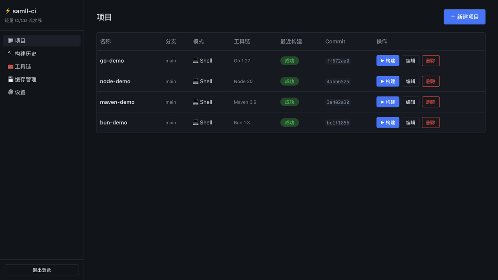

<div align="center">

# ⚡ samll-ci

**Ultra-lightweight single-binary CI/CD pipeline · 轻量单二进制 CI/CD 流水线**

拉代码 → 构建 → 打包 → 部署，一台 1 核 / 512M 的机器即可运行
`Go` · `CGO_ENABLED=0` · `SQLite` · `Embed Web UI` · [](LICENSE)

</div>

---

samll-ci 是为**资源极有限的机器**（1 核 / 512M 内存）设计的轻量 CI/CD 流水线程序，
以「时间换资源」为原则，通过内嵌 Web 控制台纯鼠标操作即可完成全部配置，无需任何配置文件。

<p align="center">
  
</p>

## 特性

- **📦 单二进制部署** — `CGO_ENABLED=0` 交叉编译（linux/amd64、arm64），约 11MB，无运行时依赖，空闲内存 ~10MB
- **🖥 内嵌控制台** — Web 控制台打包进二进制（`go:embed`），启动即访问；UI 基于本地内嵌的 [Oat UI](https://github.com/knadh/oat)（零依赖语义化组件库，无框架、无 CDN）
- **🖱 极简配置** — 无配置文件即可启动；全部配置通过控制台鼠标完成；首次启动默认密码 `admin`
- **🌐 多语言构建** — Node / Java(JDK+Maven) / Gradle / Go / Bun
- **🐳 双构建模式** — 本机 Shell + Docker（① 容器内构建 ② 产物打镜像，Dockerfile 字段区分，构建前自动探测引擎）
- **🧰 自定义工具链** — 下载地址可指向内网镜像源；Maven `settings.xml` 可视化配置；也支持直接登记宿主已有工具
- **🇨🇳 国内镜像开箱即用** — 工具链「在线版本」一键获取（清华 Adoptium / 腾讯云 / npmmirror / golang.google.cn）；构建自动注入 `GOPROXY`（goproxy.cn）与 npm registry（npmmirror）
- **🛡 512M 内存护栏** — 设置页直接配置**最大内存使用**与**最大 CPU 核数**，自动映射到各栈：
  Node `--max-old-space-size`、JVM `JAVA_TOOL_OPTIONS(-Xmx)`、Go `GOMEMLIMIT`、Docker `--memory/--cpus`、Shell Linux `taskset` 绑核；Gradle 可禁用 daemon 防内存驻留
- **💾 构建缓存** — Maven / Gradle / npm / Go / Bun 依赖与编译缓存跨次构建持久复用，一键清理
- **🔒 简单鉴权** — 单账号密码登录（bcrypt + 随机 session token），满足内网自用
- **📜 日志与状态** — 构建历史 + 状态徽章 + SSE 实时日志流（流式落盘，不占内存）

## 快速开始

```bash
# 编译（目标平台按需改 GOOS/GOARCH）
CGO_ENABLED=0 GOOS=linux GOARCH=amd64 go build -ldflags "-s -w" -o cicd .

# 运行（无配置文件，启动即用）
./cicd -data ./data -port 8080 -host 127.0.0.1
```

浏览器访问 `http://<host>:<port>`，默认密码 **`admin`**（请登录后立即在「设置」页修改）。

| 参数 | 说明 | 默认 |
|---|---|---|
| `-data` | 数据目录（db / 缓存 / 日志 / 工具链 / 产物） | `./data` |
| `-port` | 监听端口（0 = 读取设置 `server.port`） | `8080` |
| `-host` | 绑定地址 | `127.0.0.1` |

依赖：Shell 模式宿主需有 `git`；Docker 模式需 `docker` 引擎。

## 使用流程

1. **工具链**（可选）— 控制台「工具链」页新增 JDK / Maven / Gradle / Node / Go / Bun：
   点「在线版本」从国内镜像拉取版本列表一键填充下载地址，或直接填宿主已有工具路径（自动标记就绪）
2. **新建项目** — 填 Git 地址 + 分支，选构建模式与工具链，构建命令可套默认模板，填产物目录与部署命令
3. **构建** — 点击「▶ 构建」，实时查看五阶段日志（拉代码 → 准备环境 → 构建 → 打包 → 部署）
4. **产物** — 直接覆盖输出到 `outputs/<project_id>/`，不做版本号；部署命令在构建成功后自动执行

## 架构

```
internal/
├── store/       SQLite 存储层（modernc.org/sqlite，纯 Go 无 CGO）
├── auth/        bcrypt + session token 鉴权
├── executor/    可插拔执行器：Shell / Docker（容器内构建 + 产物打镜像）
├── toolchain/   工具链下载/解压/安装（tar.gz、zip、国内镜像源）
├── cachemgr/    构建缓存管理与一键清理
├── engine/      任务引擎：FIFO 队列 + 单 worker 串行 + 五阶段流水线 + 超时/取消/重启恢复
└── server/      net/http(1.22+ 路由) REST API + SSE 日志流 + 内嵌控制台
web/             原生 JS 单页控制台（Oat UI 本地内嵌，零框架零构建链）
```

- **五阶段流水线**任一阶段失败即终止；进程重启后 `running`→`failed`（日志补记中断备注）、`pending` 自动重新入队
- **日志**：构建命令 stdout/stderr 流式写入日志文件，SSE 边写边推，不整份读入内存
- **缓存**：Shell 模式用宿主持久目录 + 环境变量注入；Docker 模式用 named volume 挂载

## API

统一前缀 `/api`，除登录外均需鉴权（`Authorization: Bearer <token>` 或 cookie），响应约定 `{"code":0,"message":"ok","data":{}}`。

| 方法 | 路径 | 说明 |
|---|---|---|
| POST | `/api/login` / `/api/logout` | 登录 / 注销 |
| GET / POST / PUT / DELETE | `/api/projects[...]` | 项目 CRUD |
| POST | `/api/projects/{id}/build` | 触发构建 |
| GET | `/api/builds?project_id=&status=` | 构建历史 |
| GET | `/api/builds/{id}/log` | 日志（SSE 实时流 / 历史全文） |
| POST | `/api/builds/{id}/cancel` | 取消构建 |
| GET / POST / PUT / DELETE | `/api/toolchains[...]` | 工具链 CRUD |
| POST | `/api/toolchains/{id}/install` | 下载安装工具链 |
| GET | `/api/toolchain-versions?type=` | 在线版本发现（国内镜像源） |
| GET / POST | `/api/cache` / `/api/cache/clear` | 缓存占用 / 一键清理 |
| GET / PUT | `/api/settings`、POST `/api/password` | 全局设置 / 改密码 |

## 已验证

- 四语言（Node / Java-Maven / Go / Bun）Shell 模式闭环：拉代码→构建→打包→部署 全部成功
- 缓存复用：Maven 首次构建 17.1s → 二次 **2.0s**（m2 缓存持久复用）
- 取消 / 超时 / SSE 实时流 / 重启恢复（含中断备注）实测通过
- 工具链在线安装（npmmirror 真实下载 → 解压 → 就绪 → 用于构建）
- 空闲内存 ~10MB（要求 <50MB）；`CGO_ENABLED=0` 交叉编译 linux/amd64 + arm64 通过

> Docker 模式代码已实现（容器内构建 + 产物打镜像 + 引擎可用性探测），尚未在 Docker 环境完成端到端实测。

## 定位与非目标

面向个人 / 小团队的内网自托管场景：单账号、单 worker 串行、产物直接覆盖。
**不做**：产物版本控制与回滚、多用户 RBAC、多 worker 并行、分布式构建、Webhook 触发、日志全文检索。

## License

[MIT](LICENSE)。内嵌组件 [Oat UI](https://github.com/knadh/oat)（MIT）。
